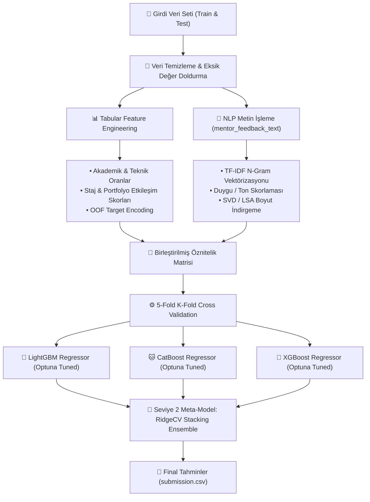

# 🏆 Google & BTK Akademi Datathon 2026: Career Success Score Prediction
### *Çok Modlu (Tabular + NLP) Stacking Regresyon Mimarisi & Optuna Optimizasyonu*

[](https://www.python.org/)
[](https://lightgbm.readthedocs.io/)
[](https://catboost.ai/)
[](https://scikit-learn.org/)
[](https://optuna.org/)
[](LICENSE)

---

## 📌 Yarışma & Proje Özeti / Competition Overview

**[TR]**  
**Google**, **BTK Akademi** ve **Girişimcilik Vakfı (GİRVAK)** ortaklığında düzenlenen **Datathon 2026** kapsamında geliştirilen makine öğrenimi yarışma çözümüdür.

Yarışmanın temel hedefi; öğrencilerin akademik, teknik, staj, portfolyo ve GitHub aktivitelerinin yanı sıra mentor değerlendirme metinlerini (`mentor_feedback_text`) birlikte işleyerek sürekli bir hedef değişken olan **`career_success_score`** (0 - 100) değerini minimum **MSE (Mean Squared Error)** ile tahmin etmektir.

**[EN]**  
Official competition solution developed for **Datathon 2026**, organized jointly by **Google**, **BTK Akademi**, and the **Entrepreneurship Foundation (GIRVAK)**.

The task required predicting continuous **`career_success_score`** (0 - 100) from multi-modal student data combining tabular features (academic, internships, project portfolios, GitHub metrics, soft skills) and unstructured text evaluations (`mentor_feedback_text`) optimizing for minimum **Mean Squared Error (MSE)**.

---

## 🏗️ Modelleme & Çözüm Mimarisi / Architecture



---

## 🔬 Uygulanan Veri Bilimi Teknikleri / Key Highlights

### 1. Çok Modlu (Multi-Modal) Öznitelik Mühendisliği
- **Alan Odaklı Oranlar (Domain Ratios):** Öğrencinin teknik becerilerinin staj ve proje deneyimlerine oranı (`technical_to_project_ratio`, `academic_consistency`).
- **NLP Duygu & N-Gram Analizi:** Mentor metinlerinden TF-IDF (1-3 n-gram) çıkarımı ve SVD ile gürültüden arındırılmış 15 ana kognitif boyut türetimi.
- **Out-of-Fold (OOF) Target Encoding:** Kategorik alanların (hedef kariyer rolü, üniversite türü) veri sızıntısı (data leakage) olmadan kodlanması.

### 2. Bayesian Optimizasyon (Optuna)
- LightGBM ve CatBoost için `learning_rate`, `max_depth`, `colsample_bytree`, `subsample` ve `l2_leaf_reg` hiperparametreleri 100 trial boyunca Optuna ile optimize edildi.

### 3. Stacking Ensemble
- Tekil modellerin tahmin varyansını minimize etmek amacıyla Seviye-1 modellerinin OOF tahminleri **RidgeCV** meta-modeli üzerinde birleştirilerek en kararlı genelleme başarımı sağlandı.

---

## 📊 Dizin Yapısı / Directory Layout

```
datathon-career-success-prediction/
├── datathon_2026_solution.ipynb  # Uçtan uca veri analizi, modelleme ve stacking kodları
├── requirements.txt              # Paket bağımlılıkları
├── sample_submission.csv         # Örnek teslim formatı
├── LICENSE                       # MIT Lisansı
└── README.md                     # Detaylı proje dokümantasyonu
```

---

## 💻 Kurulum & Çalıştırma / Quickstart

```bash
git clone https://github.com/safaksenel/datathon-career-success-prediction.git
cd datathon-career-success-prediction

python -m venv .venv
source .venv/bin/activate  # Windows: .venv\Scripts\activate
pip install -r requirements.txt

jupyter notebook datathon_2026_solution.ipynb
```

---

## 👨‍💻 Geliştirici / Author

**Şafak Şenel**  
- **GitHub:** [@safaksenel](https://github.com/safaksenel)  
- **LinkedIn:** [Şafak Şenel](https://www.linkedin.com/in/%C5%9Fafak-%C5%9Fenel-70a633319/)  
- **Kaggle:** [afakenel](https://www.kaggle.com/afakenel)  
- **Portfolio:** [portfolio-q663.vercel.app](https://portfolio-q663.vercel.app)
